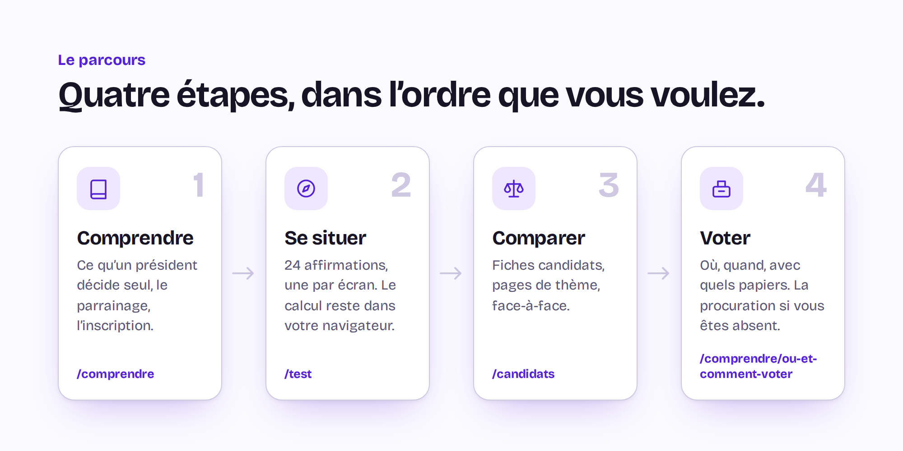
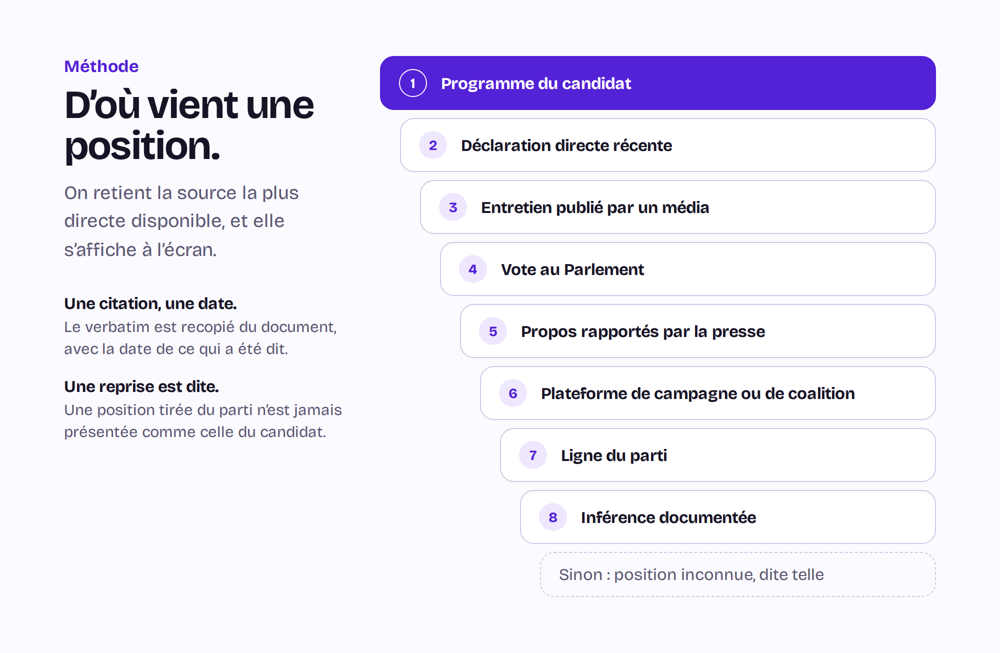
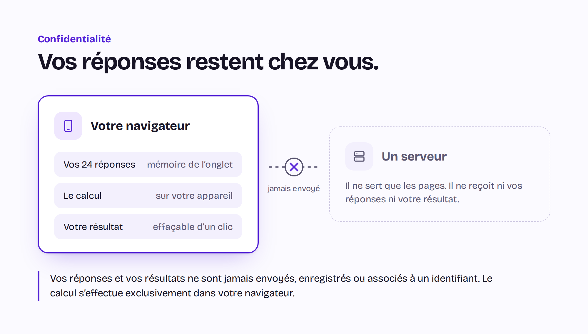

<a href="https://guide-isoloir.fr/">
  <picture>
    <source media="(prefers-color-scheme: dark)" srcset=".github/readme/accroche-sombre.png">
    
  </picture>
</a>

<p align="center">
  <a href="https://guide-isoloir.fr/test"><b>Faire le test</b></a> ·
  <a href="https://guide-isoloir.fr/candidats">Candidats</a> ·
  <a href="https://guide-isoloir.fr/themes">Thèmes</a> ·
  <a href="https://guide-isoloir.fr/comparer">Comparer</a> ·
  <a href="https://guide-isoloir.fr/comprendre">Comprendre</a> ·
  <a href="https://guide-isoloir.fr/methodologie">Méthode</a>
</p>

**[Guide Isoloir](https://guide-isoloir.fr/)** accompagne celles et ceux qui votent pour la première
fois à l'élection présidentielle française de 2027 : 1<sup>er</sup> tour le 18 avril, 2<sup>nd</sup>
tour le 2 mai.

<br>

<a href="https://guide-isoloir.fr/">
  <picture>
    <source media="(prefers-color-scheme: dark)" srcset=".github/readme/parcours-sombre.png">
    
  </picture>
</a>

| Étape      | Où aller                                                                                                                                                                                                                                                                        |
| ---------- | ------------------------------------------------------------------------------------------------------------------------------------------------------------------------------------------------------------------------------------------------------------------------------- |
| Comprendre | [Ce qu'un président décide seul](https://guide-isoloir.fr/comprendre/ce-qu-un-president-decide-seul) · [Le parrainage](https://guide-isoloir.fr/comprendre/qu-est-ce-qu-un-parrainage) · [Pour qui voter en 2027 ?](https://guide-isoloir.fr/comprendre/pour-qui-voter-en-2027) |
| Se situer  | [Le test en 24 affirmations](https://guide-isoloir.fr/test)                                                                                                                                                                                                                     |
| Comparer   | [Les candidats](https://guide-isoloir.fr/candidats) · [Les thèmes](https://guide-isoloir.fr/themes) · [Deux candidats face à face](https://guide-isoloir.fr/comparer)                                                                                                           |
| Voter      | [S'inscrire sur les listes](https://guide-isoloir.fr/comprendre/s-inscrire-sur-les-listes-electorales) · [Où et comment voter](https://guide-isoloir.fr/comprendre/ou-et-comment-voter) · [Donner procuration](https://guide-isoloir.fr/comprendre/donner-procuration)          |

**Qui est pour, qui est contre ?**
[Travail et retraites](https://guide-isoloir.fr/themes/travail-et-retraites) ·
[Fiscalité et dépense publique](https://guide-isoloir.fr/themes/fiscalite-et-depense-publique) ·
[Immigration et nationalité](https://guide-isoloir.fr/themes/immigration-et-nationalite) ·
[Écologie et énergie](https://guide-isoloir.fr/themes/ecologie-et-energie) ·
[Institutions et démocratie](https://guide-isoloir.fr/themes/institutions-et-democratie) ·
[Europe et international](https://guide-isoloir.fr/themes/europe-et-international) ·
[Économie et salaires](https://guide-isoloir.fr/themes/economie-et-salaires) ·
[Sécurité et justice](https://guide-isoloir.fr/themes/securite-et-justice) ·
[Santé et grand âge](https://guide-isoloir.fr/themes/sante-et-grand-age) ·
[Éducation, jeunesse et numérique](https://guide-isoloir.fr/themes/education-jeunesse-et-numerique) ·
[Famille et société](https://guide-isoloir.fr/themes/famille-et-societe)

<br>

<a href="https://guide-isoloir.fr/methodologie">
  <picture>
    <source media="(prefers-color-scheme: dark)" srcset=".github/readme/sources-sombre.png">
    
  </picture>
</a>

<a href="https://guide-isoloir.fr/test">
  <picture>
    <source media="(prefers-color-scheme: dark)" srcset=".github/readme/confidentialite-sombre.png">
    
  </picture>
</a>

<a href="https://guide-isoloir.fr/financement">
  <picture>
    <source media="(prefers-color-scheme: dark)" srcset=".github/readme/preuves-sombre.png">
    
  </picture>
</a>

[Méthodologie](https://guide-isoloir.fr/methodologie) ·
[Charte éditoriale](https://guide-isoloir.fr/charte-editoriale) ·
[Corrections](https://guide-isoloir.fr/corrections) ·
[Financement](https://guide-isoloir.fr/financement) ·
[Données ouvertes](https://guide-isoloir.fr/donnees) ·
[Crédits des images](https://guide-isoloir.fr/credits-images) ·
[À propos](https://guide-isoloir.fr/a-propos)

## Le code

Astro, îlots Svelte, CSS natif. Aucun backend, aucun script tiers, sortie statique.

```sh
npm ci
npm run build && npm run serve:dist   # le site construit, tel qu'il est déployé
npm run ci                            # types, lint, tests, invariants d'audit
```

Node 22 requis. Le code est sous [AGPL v3](LICENSE-AGPL-3.0), les données sous
[CC BY-SA 4.0](LICENSE-CC-BY-SA-4.0) : voir [`LICENSES.md`](LICENSES.md). Les images de ce
fichier sortent de [`scripts/generer-readme.mjs`](scripts/generer-readme.mjs).
